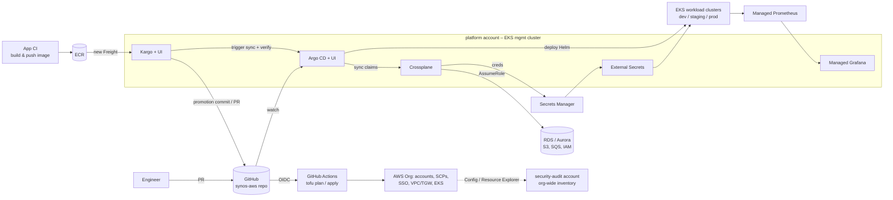

# SynosAWS – GitOps Platform for AWS

Status: Proposed · Date: 2026-11-18 · CI/CD details: [CICD.md](CICD.md) · Central portal: [PORTAL.md](PORTAL.md)

## 1. Goals

| # | Requirement | How it is met |
|---|-------------|---------------|
| G1 | Manage the **AWS Organization** (accounts, OUs, SCPs, SSO) as code | OpenTofu + Terragrunt, `foundation/` layer |
| G2 | Manage **databases** (RDS/Aurora, ElastiCache, DynamoDB) as code | Crossplane compositions, reconciled by Argo CD |
| G3 | Manage **applications** (containers + their AWS deps) as code | Helm/Kustomize on EKS, reconciled by Argo CD |
| G4 | Git is the single source of truth; no manual console changes | PR-only workflow, drift detection, SCP denies on console writes for prod |
| G5 | A **UI** that shows which resources exist, their health and drift | Argo CD UI (live state) + Grafana (metrics) + AWS Resource Explorer/Config (org-wide inventory) + optional Backstage portal |

## 2. Tool choices

| Concern | Chosen tool | Why | Rejected alternatives |
|---------|-------------|-----|-----------------------|
| Landing zone / guardrails | **AWS Control Tower** | Native account baseline, CloudTrail/Config org-wide, guardrails out of the box | Hand-rolled org (more work, same result) |
| Foundation IaC (org, accounts, SCPs, IAM Identity Center, VPC/TGW, EKS clusters) | **OpenTofu + Terragrunt** | Changes rarely, needs human-reviewed `plan`; best AWS coverage; DRY multi-account via Terragrunt | CDK (imperative, CloudFormation limits), Pulumi (smaller ecosystem for org-level work) |
| Foundation pipeline | **GitHub Actions** (OIDC → AWS, no static keys) running `plan` on PR, `apply` on merge with environment approval | No extra server to operate | Atlantis (fine choice if you want PR-comment workflow), Spacelift/env0 (paid) |
| GitOps controller | **Argo CD** (+ ApplicationSets) | Best-in-class UI showing every resource, sync & health status, diff, history | Flux (no first-class UI) |
| Promotion / continuous delivery (dev → staging → prod) | **Kargo** | Watches ECR, Git and Helm repos for new versions ("Freight"), writes the promotion commit/PR to Git, triggers Argo CD sync, runs verification, and shows what version is in which stage in its own UI. Keeps GitOps pure: CI never pushes to env folders | Argo CD Image Updater (dev only, no staged promotion), CI scripts that `sed` tags (no audit trail/UI), Spinnaker (push-based, heavy – see CICD.md §10) |
| App CI (build, test, scan, sign) | **GitHub Actions** + **Amazon ECR** (platform account) | OIDC to AWS, Trivy + Inspector scanning, cosign signing, immutable tags – see [CICD.md](CICD.md) | Jenkins, CodePipeline |
| Progressive delivery (canary/blue-green + analysis) | **Argo Rollouts** | Kargo uses its AnalysisTemplates to verify a stage before allowing promotion further | Flagger |
| Cloud resources for teams (DB, S3, SQS, IAM roles for apps) | **Crossplane** (`provider-aws` family by Upbound) with Compositions | Continuous reconciliation = automatic drift correction; every RDS instance shows up as an object in Argo CD UI; teams request a `PostgresInstance` claim, platform team controls defaults (encryption, backups, sizing) | Terraform per-app (no continuous reconcile), AWS ACK (fewer abstractions, no compositions) |
| Secrets | **External Secrets Operator** + AWS Secrets Manager | Crossplane writes DB credentials to Secrets Manager; ESO syncs them into app namespaces | Sealed Secrets (secrets in Git) |
| Policy | **Kyverno** (K8s) + **SCPs** (AWS) + **Checkov/tflint** in CI | Shift-left + runtime enforcement | OPA Gatekeeper (Rego is harder to maintain) |
| Observability | **Amazon Managed Prometheus + Amazon Managed Grafana**, CloudWatch | Managed, SSO-integrated, cross-account | Self-hosted Prometheus stack |
| Org-wide inventory | **AWS Config aggregator + Resource Explorer + Security Hub** (delegated admin in Security/Audit account) | Shows *every* resource across all accounts, including ones not created by GitOps (drift/shadow IT) | Third-party CSPM |
| Developer portal (phase 3, optional) | **Backstage** with Argo CD + Kubernetes + AWS plugins | One page per service: its app, its DB, its owners, its dashboards | Port.io (SaaS) |

**Key design decision — two IaC layers:**
- **Layer 1 (OpenTofu)** builds what the platform runs *on*: org, accounts, network, EKS clusters, bootstrap of Argo CD. Run by pipeline, reviewed via `plan`.
- **Layer 2 (Crossplane + Argo CD)** builds what teams *consume*: databases, buckets, queues, apps. Continuously reconciled and visible in the Argo CD UI.

This avoids the two common failure modes: putting the AWS Organization inside Kubernetes (chicken-and-egg), and putting every app database in a slow Terraform pipeline with no live view.

## 3. AWS Organization layout

```
Root (Management account – billing, Control Tower, Organizations only)
├── OU: Security
│   ├── log-archive          (CloudTrail, Config, VPC flow logs – immutable S3)
│   └── security-audit       (Security Hub, GuardDuty, Config aggregator, Resource Explorer – delegated admin)
├── OU: Infrastructure
│   ├── network              (Transit Gateway, Route53, egress VPC, IPAM)
│   └── platform             (EKS mgmt cluster: Argo CD, Crossplane, Grafana, Backstage; ECR)
├── OU: Workloads
│   ├── OU: NonProd
│   │   ├── dev              (EKS workload cluster + RDS/Aurora)
│   │   └── staging
│   └── OU: Prod
│       └── prod
└── OU: Sandbox               (individual experiments, budget-capped)
```

SCP highlights: deny leaving the org, deny disabling CloudTrail/Config/GuardDuty, region allow-list, deny root user, deny IAM user creation in workload accounts, prod: deny write APIs from non-pipeline roles.

## 4. Architecture



Flow for a new database:
1. Developer adds `apps/orders/dev/database.yaml` (a `PostgresInstance` claim: size `small`, engine 16).
2. CI validates (kubeconform, Kyverno CLI), reviewer approves, merge.
3. Argo CD syncs the claim → Crossplane composes Aurora cluster, subnet group, security group, KMS key, parameter group in the `dev` account.
4. Credentials land in Secrets Manager → ESO → `orders` namespace.
5. Argo CD UI shows the claim tree and every AWS resource as Healthy/Synced; manual console edits are reverted automatically.

Flow for a new application version (Kargo):
1. App CI builds and pushes `orders:1.4.0` to ECR. CI never touches the GitOps repo.
2. Kargo `Warehouse` detects the new tag and creates **Freight** (image tag + Git commit of `apps/orders/base`).
3. `dev` Stage auto-promotes: Kargo clones the repo, updates `apps/orders/dev/values.yaml`, commits, pushes and asks Argo CD to sync `orders-dev`.
4. Verification (Argo Rollouts AnalysisTemplate: error rate, latency from Prometheus) marks the Freight as verified in `dev`.
5. `staging` accepts only Freight verified in `dev`; `prod` accepts only Freight verified in `staging`, and promotes by **opening a PR** that a human approves.
6. Kargo UI shows which Freight is in each stage; one click (or PR merge) moves it forward, rollback = promote older Freight.

## 5. Repository layout (monorepo)

```
synos-aws/
├── foundation/                     # Layer 1 – OpenTofu + Terragrunt
│   ├── modules/                    # org, scp, sso, vpc, tgw, eks, argocd-bootstrap
│   ├── live/
│   │   ├── terragrunt.hcl          # remote state (S3 + DynamoDB lock) per account
│   │   ├── management/             # organization, OUs, SCPs, Identity Center
│   │   ├── network/
│   │   ├── platform/               # mgmt EKS + Argo CD bootstrap
│   │   ├── dev/ staging/ prod/     # workload VPC + EKS
│   └── .tflint.hcl
├── platform/                       # Layer 2 – reconciled by Argo CD
│   ├── argocd/                     # app-of-apps, ApplicationSets, projects, RBAC
│   ├── kargo/                      # Kargo install, shared PromotionTasks, ClusterAnalysisTemplates
│   ├── crossplane/
│   │   ├── providers/              # provider-aws-rds, -s3, -iam, ... + ProviderConfigs per account
│   │   ├── xrds/                   # XPostgresInstance, XBucket, XQueue definitions
│   │   └── compositions/           # opinionated AWS implementations
│   ├── addons/                     # ESO, Kyverno, cert-manager, ALB controller, Karpenter
│   └── policies/                   # Kyverno policies
├── apps/                           # Layer 2 – one folder per service
│   └── orders/
│       ├── base/                   # Helm values / Kustomize base
│       ├── dev/  (database.yaml, values.yaml)
│       ├── staging/
│       ├── prod/
│       └── kargo/                  # Project, Warehouse, Stages (dev, staging, prod)
├── .github/workflows/              # tofu-plan.yml, tofu-apply.yml, validate-manifests.yml
└── docs/
```

Promotion: dev → staging → prod is driven by **Kargo**, which writes the change into the env folder (direct commit for dev/staging, PR for prod). Humans can still edit env folders by PR; Kargo only owns the version fields (image tag, chart version). Prod Argo CD project keeps a sync window.

## 6. Monitoring UI – what each screen answers

| Question | UI |
|----------|----|
| What did Git declare, is it deployed, is it drifted? | **Argo CD** (resource tree per app/DB, diff, sync history) |
| Which version is in dev / staging / prod, was it verified, who promoted it? | **Kargo** (Freight timeline per stage, promotion history, one-click promote/rollback) |
| Is the database / app healthy and performant? | **Grafana** (RDS Performance Insights, CloudWatch, Prometheus dashboards) |
| What exists anywhere in the org, including non-GitOps resources? | **AWS Resource Explorer / Config aggregator** in security-audit account |
| Security posture & compliance | **Security Hub** (CIS / AWS Foundational benchmarks) |
| Who owns what, single pane per service | **Backstage** (phase 3) |
| Cost per account / team | **Cost Explorer** with `team`/`env` tags enforced by Kyverno + SCP tag policies |

## 7. Security model

- No long-lived keys: GitHub Actions → `AWSReservedSSO`-independent IAM roles via OIDC; Crossplane uses IRSA/EKS Pod Identity in `platform` and assumes a scoped `crossplane-provisioner` role in each workload account.
- Human access only through IAM Identity Center permission sets (ReadOnly default; break-glass role audited).
- State bucket: versioned, KMS-encrypted, in management or platform account, per-account state keys.
- Argo CD SSO via Identity Center (SAML/OIDC); RBAC per AppProject = per team.
- Kargo SSO via Identity Center (OIDC); a Kargo Project per team; promotion to prod limited to release managers. Kargo pushes to Git with a GitHub App (scoped to the GitOps repo), reads ECR via Pod Identity.

## 8. Rollout plan

| Phase | Scope | Outcome |
|-------|-------|---------|
| 0 | Enable Control Tower manually in management account; create the GitHub repo; OIDC role | Landing zone + pipeline identity |
| 1 | `foundation/`: OUs, accounts, SCPs, Identity Center, network, platform EKS, Argo CD bootstrap | Org fully in code |
| 2 | Crossplane + compositions for Postgres/S3/SQS; ESO; first app in `dev` | Self-service DB + app via PR, visible in Argo CD |
| 3 | staging/prod clusters, Kargo + Argo Rollouts promotion pipeline, Grafana dashboards, Security Hub, Resource Explorer | Production ready |
| 4 | Backstage portal + software templates ("new service" creates app folder + DB claim) | Developer self-service UI |

## 9. Open decisions

- Workload clusters: one EKS per environment (recommended) vs shared cluster with namespaces.
- Database engine standard: Aurora PostgreSQL (recommended) vs RDS per service.
- Git host: GitHub assumed; GitLab works the same (swap Actions for GitLab CI).
- Pipeline UX: GitHub Actions (default) vs Atlantis if teams prefer `atlantis plan` comments on PRs.
