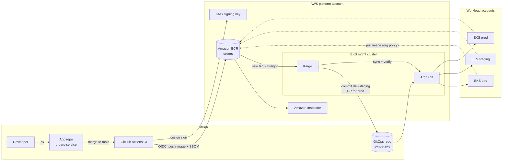
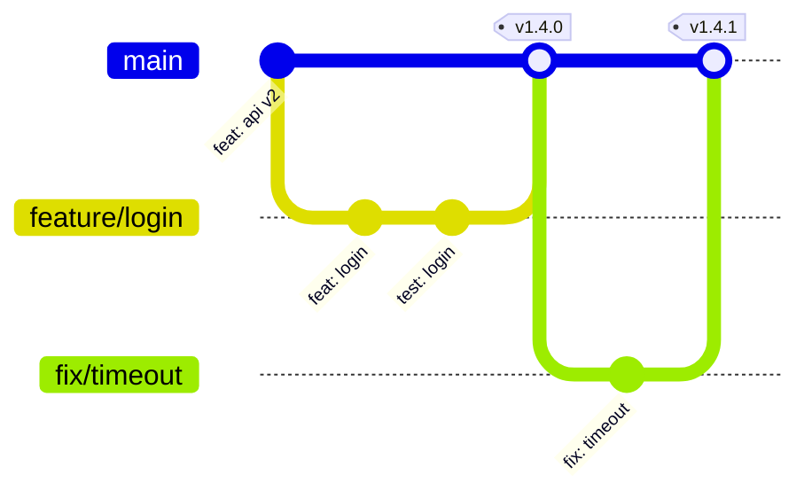
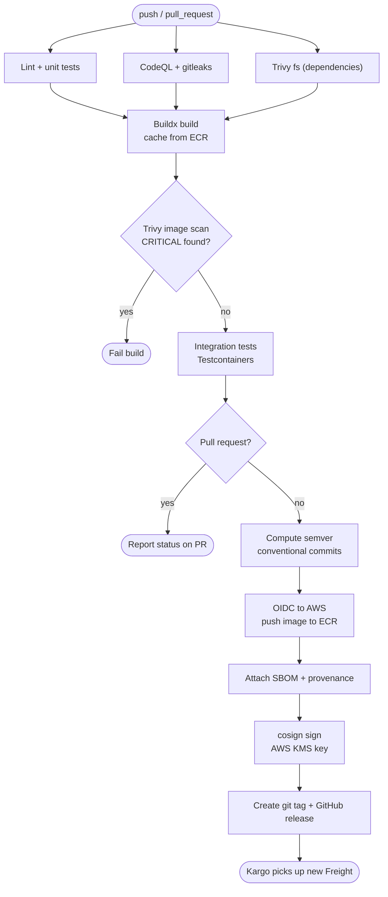
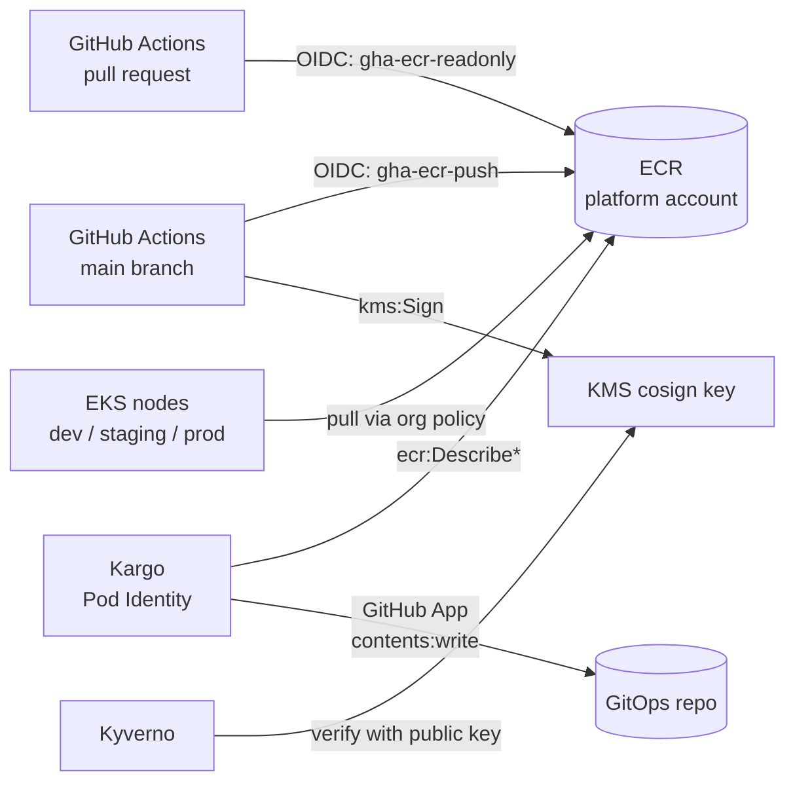
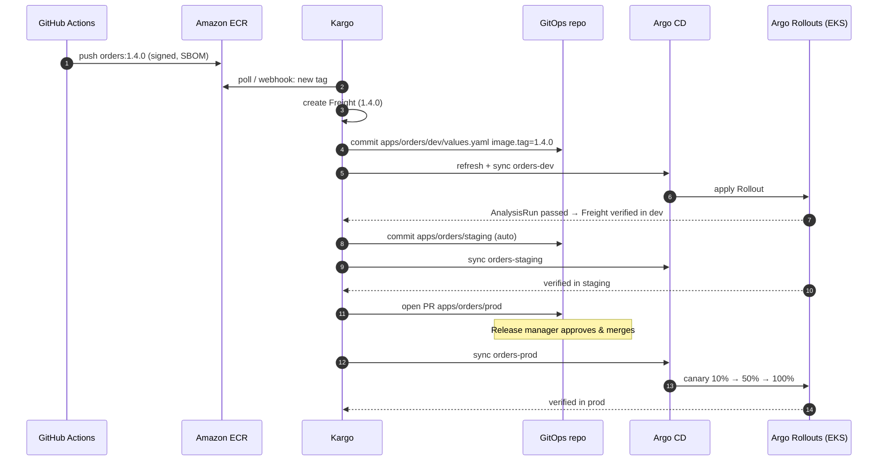

# SynosAWS – CI/CD Design (GitHub Actions · Amazon ECR · Kargo · Argo CD)

Status: Proposed · Date: 2026-11-18 · Related: [ARCHITECTURE.md](ARCHITECTURE.md)

## 1. Goals

| # | Goal |
|---|------|
| C1 | Every change is built, tested and scanned automatically in **GitHub Actions** |
| C2 | Images are stored in **Amazon ECR** (private, encrypted, scanned, immutable tags) |
| C3 | CI never deploys and never needs cluster credentials; **CD is pull-based GitOps** |
| C4 | Promotion dev → staging → prod is automated, verified and auditable (**Kargo + Argo CD**) |
| C5 | Only signed images built by our pipeline can run in EKS (supply-chain security) |
| C6 | No long-lived AWS keys anywhere (GitHub OIDC, EKS Pod Identity) |

## 2. Toolchain

| Stage | Tool | Notes |
|-------|------|-------|
| Source & PR review | **GitHub** | Branch protection, CODEOWNERS, required checks |
| CI orchestration | **GitHub Actions** | Reusable workflows in a central `synos/.github` repo |
| Lint / unit test | Language tooling (eslint, go test, pytest, …) | Runs on every PR |
| SAST / secrets | **CodeQL**, **gitleaks** | Results in GitHub Security tab |
| Dependency scan | **Dependabot** + **Trivy fs** | |
| Build | **Docker Buildx** (`docker/build-push-action`) | Layer cache in ECR (`cache-to type=registry`) |
| Image scan | **Trivy** (CI gate) + **Amazon Inspector** (continuous, on push) | CI blocks on CRITICAL; Inspector re-scans when new CVEs appear |
| SBOM / provenance | **Syft** (SPDX), BuildKit provenance attestation | Stored as OCI artifacts next to the image in ECR |
| Integration test | **Testcontainers** / `docker compose` in the runner | Real Postgres, Redis, LocalStack |
| Registry | **Amazon ECR** (platform account) | Org-wide pull, replication, lifecycle |
| Signing | **cosign** with **AWS KMS** key | Verified at admission by **Kyverno** |
| Promotion | **Kargo** | Warehouse → Freight → Stages |
| Deployment | **Argo CD** (+ **Argo Rollouts** for canary) | Pull-based sync to EKS |
| Verification | Argo Rollouts **AnalysisTemplates** (Prometheus) | Gate between stages |
| Notifications | Kargo / Argo CD notifications → Slack | |

## 3. End-to-end flow



**Separation of duties:** CI produces artifacts (images). Kargo decides *which* artifact goes *where* by writing Git. Argo CD makes clusters match Git. No component outside the platform cluster holds cluster credentials.

## 4. Repositories and branching

| Repo | Contents | Who writes |
|------|----------|-----------|
| `orders-service`, `payments-service`, … | Application code, `Dockerfile`, tests, `.github/workflows/ci.yml` (calls reusable workflow) | Developers |
| `synos/.github` | Reusable workflows (`container-ci.yml`), shared actions | Platform team |
| `synos-aws` (GitOps) | `foundation/`, `platform/`, `apps/<svc>/{base,dev,staging,prod,kargo}` | Platform team, developers (PR), **Kargo bot** (version fields only) |

Trunk-based development with conventional commits; versions are computed automatically on merge:



| Event | CI does | Image tags pushed |
|-------|---------|-------------------|
| Pull request | lint, test, SAST, build, Trivy scan, integration test | none (build only) |
| Merge to `main` | all of the above + compute next semver, git tag, push, SBOM, sign | `1.4.0`, `sha-3f9c2ab` |
| Manual `workflow_dispatch` hotfix | same as main, from a `release/*` branch | `1.3.2` |

Kargo subscribes with `SemVer` strategy, so every merge to `main` becomes Freight.

## 5. CI pipeline (GitHub Actions)



### 5.1 Caller workflow (in each service repo)

```yaml
# orders-service/.github/workflows/ci.yml
name: ci
on:
  pull_request:
  push:
    branches: [main]
jobs:
  container:
    uses: synos/.github/.github/workflows/container-ci.yml@v1
    with:
      service: orders
      test-command: make test
      integration-command: make it
    permissions:
      contents: write        # git tag / release
      id-token: write        # GitHub OIDC -> AWS
      security-events: write # upload scan results
```

### 5.2 Reusable workflow (platform team owns it)

```yaml
# synos/.github/.github/workflows/container-ci.yml
on:
  workflow_call:
    inputs:
      service:             { type: string, required: true }
      test-command:        { type: string, default: make test }
      integration-command: { type: string, default: "" }

env:
  AWS_REGION: ap-southeast-1
  ECR: 123456789012.dkr.ecr.ap-southeast-1.amazonaws.com   # platform account

jobs:
  test:
    runs-on: ubuntu-latest
    steps:
      - uses: actions/checkout@v4
      - run: ${{ inputs.test-command }}
      - uses: aquasecurity/trivy-action@0.28.0
        with: { scan-type: fs, severity: "CRITICAL,HIGH", exit-code: "1" }

  build:
    needs: test
    runs-on: ubuntu-latest
    steps:
      - uses: actions/checkout@v4
        with: { fetch-depth: 0 }

      - uses: aws-actions/configure-aws-credentials@v4
        with:
          role-to-assume: arn:aws:iam::123456789012:role/gha-ecr-${{ github.event_name == 'push' && 'push' || 'readonly' }}
          aws-region: ${{ env.AWS_REGION }}
      - uses: aws-actions/amazon-ecr-login@v2
      - uses: docker/setup-buildx-action@v3

      - name: Build (load locally for scanning)
        uses: docker/build-push-action@v6
        with:
          load: true
          tags: ${{ inputs.service }}:candidate
          cache-from: type=registry,ref=${{ env.ECR }}/${{ inputs.service }}:buildcache

      - name: Image scan gate
        uses: aquasecurity/trivy-action@0.28.0
        with: { image-ref: "${{ inputs.service }}:candidate", severity: CRITICAL, exit-code: "1", ignore-unfixed: true }

      - name: Integration tests
        if: inputs.integration-command != ''
        run: ${{ inputs.integration-command }}

      - name: Compute version
        if: github.event_name == 'push'
        id: ver
        uses: mathieudutour/github-tag-action@v6.2
        with: { github_token: "${{ secrets.GITHUB_TOKEN }}", dry_run: true }

      - name: Push image + SBOM + provenance
        if: github.event_name == 'push'
        id: push
        uses: docker/build-push-action@v6
        with:
          push: true
          sbom: true
          provenance: mode=max
          tags: |
            ${{ env.ECR }}/${{ inputs.service }}:${{ steps.ver.outputs.new_version }}
            ${{ env.ECR }}/${{ inputs.service }}:sha-${{ github.sha }}
          cache-from: type=registry,ref=${{ env.ECR }}/${{ inputs.service }}:buildcache
          cache-to:   type=registry,ref=${{ env.ECR }}/${{ inputs.service }}:buildcache,mode=max,image-manifest=true

      - name: Sign by digest
        if: github.event_name == 'push'
        uses: sigstore/cosign-installer@v3
      - if: github.event_name == 'push'
        run: cosign sign --yes --tlog-upload=false --key awskms:///alias/synos-cosign ${{ env.ECR }}/${{ inputs.service }}@${{ steps.push.outputs.digest }}

      - name: Tag release
        if: github.event_name == 'push'
        uses: mathieudutour/github-tag-action@v6.2
        with: { github_token: "${{ secrets.GITHUB_TOKEN }}", custom_tag: "${{ steps.ver.outputs.new_version }}" }
```

> Pin third-party actions to a commit SHA in production (Dependabot keeps them updated). Versions above are illustrative.

## 6. Amazon ECR design

| Setting | Value | Why |
|---------|-------|-----|
| Location | **platform account**, one repo per service (`orders`, `payments`, …), created by OpenTofu | Single source of images for all environments |
| Tag mutability | **IMMUTABLE** (exclusion filter for `buildcache`) | A tag always means the same bytes → reproducible promotion |
| Encryption | KMS customer-managed key | Cross-account decrypt is controlled |
| Scanning | **Amazon Inspector enhanced scanning**, continuous | Findings → Security Hub (security-audit account) |
| Pull access | Repository policy: `ecr:BatchGetImage` for `aws:PrincipalOrgID = o-xxxx` + `aws:PrincipalTag/role = eks-node` | Every workload account can pull, nobody outside the org |
| Push access | Only role `gha-ecr-push`, trusted for `repo:synos/*:ref:refs/heads/main` via GitHub OIDC | PR builds can't publish images |
| Lifecycle | Keep last 50 semver tags; expire `sha-*` after 30 days; expire untagged after 7 days | Cost control |
| Replication | Cross-region replication to DR region (if required) | Pull locally during regional outage |
| Pull-through cache | Docker Hub, ghcr.io, quay.io, public.ecr.aws | Base images without rate limits, scanned by Inspector |

GitHub OIDC trust policy for the push role:

```json
{
  "Effect": "Allow",
  "Principal": { "Federated": "arn:aws:iam::123456789012:oidc-provider/token.actions.githubusercontent.com" },
  "Action": "sts:AssumeRoleWithWebIdentity",
  "Condition": {
    "StringEquals": { "token.actions.githubusercontent.com:aud": "sts.amazonaws.com" },
    "StringLike":   { "token.actions.githubusercontent.com:sub": "repo:synos/*:ref:refs/heads/main" }
  }
}
```

### Identity and access overview



## 7. CD: promotion with Kargo and Argo CD

| Stage | Source of Freight | Promotion | Gate to next stage |
|-------|-------------------|-----------|--------------------|
| **dev** | Warehouse (every new semver) | Automatic, direct commit to `apps/<svc>/dev` | AnalysisTemplate: error rate < 1 %, p95 latency, smoke test Job |
| **staging** | Freight verified in dev | Automatic (or one click) | Analysis + E2E test Job + manual sign-off for major versions |
| **prod** | Freight verified in staging | **PR** to `apps/<svc>/prod`, approved by release manager; Argo Rollouts canary 10 % → 50 % → 100 % | Canary analysis; automatic abort + rollback |



**Rollback:** in Kargo UI choose the previous Freight for the stage → Kargo writes the old tag to Git → Argo CD syncs. Failed canary in prod is aborted by Argo Rollouts automatically before Kargo is even involved.

**Database changes:** Crossplane claims live next to the app (`apps/<svc>/<env>/database.yaml`). The Warehouse also subscribes to `apps/<svc>/base` in Git, so infra and app changes travel together. Schema migrations run as an Argo CD `PreSync` hook Job (Flyway / Atlas / Liquibase) using the image of the release.

## 8. Runtime enforcement (supply chain)

```yaml
# platform/policies/verify-images.yaml
apiVersion: kyverno.io/v1
kind: ClusterPolicy
metadata: { name: verify-synos-images }
spec:
  validationFailureAction: Enforce
  webhookTimeoutSeconds: 15
  rules:
  - name: only-signed-ecr-images
    match: { any: [{ resources: { kinds: [Pod] } }] }
    verifyImages:
    - imageReferences: ["123456789012.dkr.ecr.ap-southeast-1.amazonaws.com/*"]
      mutateDigest: true          # pin tag -> digest at admission
      attestors:
      - entries:
        - keys:
            kms: awskms:///arn:aws:kms:ap-southeast-1:123456789012:alias/synos-cosign
            rekor: { ignoreTlog: true }
  - name: only-our-registry
    match: { any: [{ resources: { kinds: [Pod] } }] }
    validate:
      message: "Images must come from Synos ECR"
      pattern:
        spec:
          containers:
          - image: "123456789012.dkr.ecr.ap-southeast-1.amazonaws.com/*"
```

## 9. Where to look (UIs)

| Question | UI |
|----------|----|
| Did my PR build / test / scan pass? | **GitHub Actions** + GitHub Security tab |
| Which images exist, what vulnerabilities do they have? | **ECR console** + **Amazon Inspector** / **Security Hub** |
| Which version is in dev / staging / prod, who promoted, verified? | **Kargo UI** |
| Is the deployment synced and healthy, what resources were created? | **Argo CD UI** |
| How is the canary doing? | **Argo Rollouts dashboard** / Grafana |
| Pipeline metrics (lead time, deployment frequency, failure rate) | **Grafana** (DORA dashboard from GitHub + Kargo events) |

## 10. Spinnaker evaluation

Spinnaker was considered as the CD/promotion tool.

| Criterion | Kargo + Argo CD | Spinnaker |
|-----------|-----------------|-----------|
| Model | **Pull-based GitOps**; Git is the source of truth | **Push-based**; Spinnaker calls the cluster API, state lives in Spinnaker |
| Drift correction | Continuous (Argo CD) | None after deploy |
| Operational footprint | 2 lightweight controllers in the existing EKS | ~10 microservices (Deck, Gate, Orca, Clouddriver, Front50, Echo, Igor, Rosco, Fiat, Kayenta) + Redis/SQL; Halyard/operator to manage |
| Kubernetes-native config | CRDs in Git | Pipelines as JSON (managed via Spinnaker UI or Dinghy/sponnet) |
| Canary analysis | Argo Rollouts AnalysisTemplates | Kayenta (strong, mature) |
| Non-Kubernetes targets (EC2/ASG with AMI bake, Lambda, ECS) | Limited (via Crossplane/Argo CD workarounds) | **Strong** – original strength |
| Crossplane / database promotion | Same Git flow as apps | Separate mechanism needed |
| Community momentum (2026) | Growing (CNCF Argo ecosystem, Akuity) | Mature but slower; smaller contributor base |
| Fits our UI goal | Kargo UI + Argo CD UI show both promotion and live resources | Good pipeline UI, no live drift/resource view |

**Decision: do not adopt Spinnaker.** All target workloads run on EKS and the platform is GitOps-first; Spinnaker would duplicate Kargo + Argo CD, add a large system to operate, and move the source of truth out of Git.

**Revisit if:** we must deploy **EC2/ASG AMI-based** or legacy ECS workloads at scale with bake-and-deploy pipelines, or need multi-cloud VM deployments. In that case Spinnaker would run *alongside* (for VMs only), not replace Kargo for Kubernetes.

## 11. Rollout plan

| Phase | Deliverable |
|-------|-------------|
| 1 | GitHub org settings, OIDC provider + `gha-ecr-*` roles, ECR repos via OpenTofu, reusable `container-ci.yml` |
| 2 | First service on CI: build, test, Trivy, push to ECR, SBOM |
| 3 | Kargo installed in platform cluster; `dev` stage auto-promotion with Argo CD |
| 4 | staging + prod stages, Argo Rollouts canary, AnalysisTemplates, prod PR flow |
| 5 | cosign signing + Kyverno `Enforce`; Inspector → Security Hub; DORA dashboard |
| 6 | Onboard remaining services using a Backstage template (repo + CI + Kargo + Argo CD app in one click) |

## 12. Open decisions

- Version scheme: automatic semver from conventional commits (proposed) vs release-please PRs.
- Signing: KMS key cosign (proposed, private) vs Sigstore keyless with GitHub OIDC (public transparency log).
- Runners: GitHub-hosted (proposed) vs self-hosted on EKS with Actions Runner Controller (needed if builds must reach private VPC resources).
- Prod approval: GitHub PR review (proposed) vs Kargo manual promotion with RBAC.
