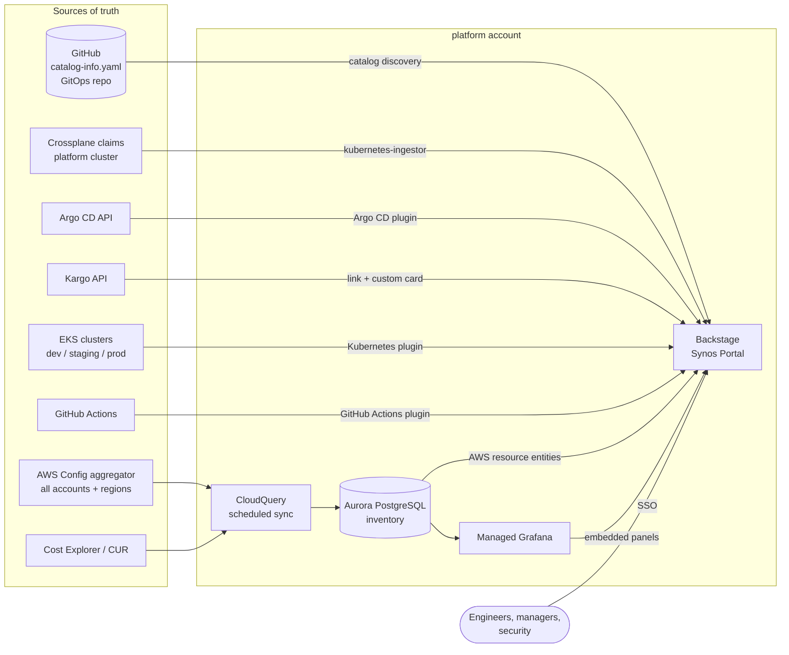
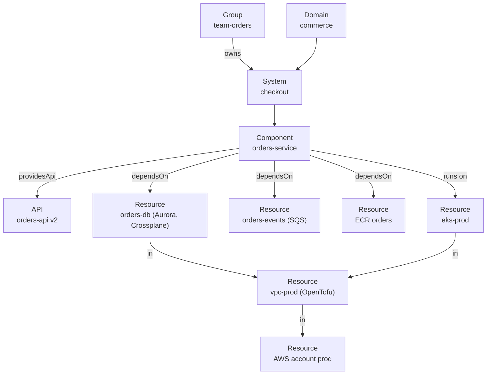
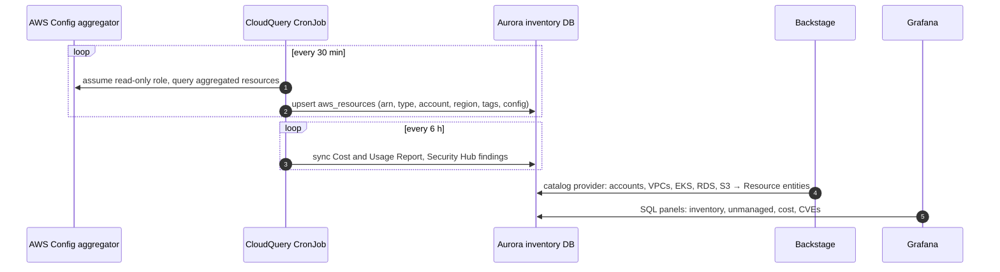

# SynosAWS – Central View of Infrastructure and Applications

Status: Proposed · Date: 2026-11-18 · Related: [ARCHITECTURE.md](ARCHITECTURE.md), [CICD.md](CICD.md)

## 1. Problem

Each tool shows only one slice:

| Tool | Sees | Doesn't see |
|------|------|-------------|
| Argo CD | What Git declares in Kubernetes, sync/health | Foundation layer (OpenTofu), anything created outside Git |
| Kargo | Which version is in which stage | Infrastructure, runtime health |
| Crossplane | Databases/buckets it manages | Org, VPC, EKS, console-created resources |
| OpenTofu | Its state files | Everything else; no UI |
| AWS Console | Everything, per account/region | Ownership, apps, Git, versions |

**Goal:** one place where anyone can answer *"what exists, who owns it, which version runs where, is it healthy, what does it cost, and is it managed by Git?"*, for **apps and infrastructure across all accounts**.

## 2. Decision

| Layer | Tool | Role |
|-------|------|------|
| **Single entry point** | **Backstage** ("Synos Portal") in the platform EKS cluster | Software catalog: every team, system, app, database, cluster and AWS account as linked entities, with live status cards |
| **Inventory data lake** | **AWS Config aggregator** (security-audit account) → **CloudQuery** → **Aurora PostgreSQL** (`inventory` DB) | Complete, org-wide list of *all* AWS resources, including ones not created by GitOps |
| **Dashboards** | **Amazon Managed Grafana** | Inventory, drift ("unmanaged resources"), cost, DORA, runtime metrics |
| **Deep-dive tools** (linked from portal) | Argo CD, Kargo, Argo Rollouts, GitHub Actions, AWS Console | Operations stay in the specialised tools; the portal links straight to the right page |
| **Glue** | **Mandatory tags** + `catalog-info.yaml` | Lets every resource be connected to a team, system and environment |

Alternatives considered:

| Option | Verdict |
|--------|---------|
| **Port.io / Cortex** (SaaS portals) | Faster to start, less maintenance, but paid and data leaves AWS. Good fallback if the team can't run Backstage. |
| **AWS myApplications / AppRegistry** | Free, shows cost + CloudWatch health per app tag, but AWS-only: no Git, versions, Kargo or Argo CD. Use it *as a data source*, not as the portal. |
| **Grafana only** | Good for numbers and dashboards, poor for ownership, relations and docs. Keep it as the dashboard layer. |
| **Steampipe** instead of CloudQuery | Fine for ad-hoc SQL; CloudQuery is better for scheduled syncs into a persistent DB. |

## 3. Architecture



## 4. Catalog model

Everything is an entity with an owner, linked by relations. The portal page for a service shows its whole tree.



| Entity | Source | How it gets into the catalog |
|--------|--------|------------------------------|
| Group / User | IAM Identity Center or GitHub teams | GitHub org provider (or LDAP/Entra sync) |
| Domain / System | `platform/catalog/*.yaml` in GitOps repo | Static location |
| Component / API | `catalog-info.yaml` in each service repo | GitHub discovery (all repos in org) |
| Database / bucket / queue (Crossplane) | Crossplane claims in platform cluster | TeraSky `kubernetes-ingestor` creates Resource entities automatically |
| AWS account, VPC, EKS, other AWS resources | Inventory DB (from AWS Config) | Custom catalog provider reading `inventory`, or Roadie AWS catalog modules |

## 5. Tag standard (the glue)

Enforced by **AWS Organizations tag policies** + **SCP deny on create without tags** (workload accounts), **OpenTofu `default_tags`**, **Crossplane Composition patches**, and **Kyverno** (K8s labels).

| Tag / label | Example | Used for |
|-------------|---------|----------|
| `synos:owner` | `team-orders` | Ownership in catalog, alerts routing |
| `synos:system` | `checkout` | Grouping in catalog and cost |
| `synos:component` | `orders-service` | Links resource → app page |
| `synos:env` | `prod` | Filters, cost per env |
| `synos:managed-by` | `opentofu` / `crossplane` / `argocd` | **Drift dashboard**: anything without it is unmanaged |
| `synos:source` | `github.com/synos/synos-aws//foundation/live/prod/network` | Jump from resource to its code |
| `awsApplication` | AppRegistry ARN | Feeds AWS myApplications cost/health view |

```hcl
# foundation/live/terragrunt.hcl – every OpenTofu resource is tagged
generate "provider" {
  path      = "provider.tf"
  if_exists = "overwrite"
  contents  = <<-EOF
    provider "aws" {
      default_tags {
        tags = {
          "synos:managed-by" = "opentofu"
          "synos:source"     = "github.com/synos/synos-aws//foundation/live/${path_relative_to_include()}"
          "synos:env"        = "${local.env}"
          "synos:owner"      = "team-platform"
        }
      }
    }
  EOF
}
```

## 6. What a service page shows

```
┌ orders-service ─────────────────────────────── owner: team-orders · system: checkout ┐
│ Overview │ CI │ Deployments │ Infrastructure │ Kubernetes │ Metrics │ Cost │ Docs  │
├──────────────────────────────────────────────────────────────────────────────────────┤
│ Versions (Kargo)     dev 1.4.1 ✅   staging 1.4.0 ✅   prod 1.3.9 ✅  [open Kargo]     │
│ Argo CD              orders-dev Synced/Healthy · orders-prod Synced/Healthy          │
│ Last CI run          main #812 ✅ 6m ago · image signed · 0 critical CVEs            │
│ Infrastructure       orders-db  Aurora PG 16  small  Ready  (Crossplane)            │
│                      orders-events  SQS  Ready  (Crossplane)                         │
│ Kubernetes (prod)    6/6 pods running · 0 restarts · HPA 6/12                        │
│ Metrics (Grafana)    p95 182 ms · error rate 0.2 % · RDS CPU 31 %                   │
│ Cost (30d)           $1,240  (RDS 61 %, EKS 32 %, other 7 %)                         │
└──────────────────────────────────────────────────────────────────────────────────────┘
```

Plus portal-wide views:

| View | Shows | Built with |
|------|-------|-----------|
| **Infrastructure explorer** | All accounts → VPCs → clusters → databases, filter by owner/env | Backstage catalog graph + inventory |
| **Environment board** | Every app × dev/staging/prod with version and health | Kargo + Argo CD plugins |
| **Unmanaged resources (drift)** | AWS resources with no `synos:managed-by` tag, per account and owner | Grafana on `inventory` |
| **Security** | Inspector CVEs per image/app, Security Hub score per account | Inventory + Security Hub |
| **Cost** | Cost per team/system/env | CUR → inventory → Grafana, embedded in Backstage |
| **Scorecards** | Has owner? docs? signed images? backups on? | Backstage Tech Insights |

## 7. Example: `catalog-info.yaml` in a service repo

```yaml
apiVersion: backstage.io/v1alpha1
kind: Component
metadata:
  name: orders-service
  annotations:
    github.com/project-slug: synos/orders-service
    backstage.io/kubernetes-label-selector: app.kubernetes.io/name=orders
    argocd/app-selector: app.kubernetes.io/name=orders
    grafana/dashboard-selector: "tags @> 'orders'"
    backstage.io/techdocs-ref: dir:.
    synos.io/kargo-project: orders
    synos.io/aws-component-tag: orders-service   # joins to inventory via synos:component
spec:
  type: service
  lifecycle: production
  owner: team-orders
  system: checkout
  providesApis: [orders-api]
  dependsOn:
    - resource:orders-db          # auto-created from the Crossplane claim
    - resource:orders-events
```

## 8. Inventory pipeline



Example drift query used in Grafana:

```sql
SELECT account_id, region, resource_type, arn, tags->>'synos:owner' AS owner
FROM aws_resources
WHERE tags->>'synos:managed-by' IS NULL
  AND resource_type NOT IN ('AWS::Config::ResourceCompliance')   -- noise filter
ORDER BY account_id, resource_type;
```

## 9. Backstage plugins

| Need | Plugin |
|------|--------|
| Kubernetes workloads across clusters | `@backstage/plugin-kubernetes` (EKS auth via Pod Identity) |
| Argo CD sync/health/history | `@roadiehq/backstage-plugin-argo-cd` |
| Crossplane claims → catalog + resource graph | TeraSky `kubernetes-ingestor` + `crossplane-resources` |
| CI runs | `@backstage-community/plugin-github-actions` |
| Dashboards | `@backstage-community/plugin-grafana` |
| AWS resources | Custom provider on `inventory` DB, or `@roadiehq/catalog-backend-module-aws` |
| Kargo | Link-out annotation; small custom card using the Kargo API (check the Backstage plugin marketplace first) |
| Docs | TechDocs (Markdown in each repo, including these design docs) |
| Self-service | Scaffolder templates: "new service" (repo + CI + Kargo + Argo CD app + DB claim) |
| Quality | Tech Insights scorecards |

Exact package names and versions change; check the Backstage plugin directory when installing.

## 10. Deployment and security

- Backstage runs in the **platform EKS cluster**, deployed by Argo CD; its own database is a Crossplane `PostgresInstance` claim.
- **SSO** via IAM Identity Center (OIDC); catalog visibility and actions governed by the Backstage permission framework (team owns → can run templates for its components).
- **Read-only everywhere:** Backstage and CloudQuery use read-only roles (`ViewOnlyAccess` + `ReadOnlyAccess` scoped), Argo CD/Kargo tokens with read roles. Changes still happen only through Git PRs.
- `inventory` DB is private, KMS-encrypted; Grafana connects through a VPC data source.

## 11. Rollout

| Phase | Deliverable | Value |
|-------|-------------|-------|
| 1 | Tag policy + `default_tags` + Crossplane tag patches; AWS Config aggregator | Every resource is attributable |
| 2 | CloudQuery → inventory DB → Grafana: inventory, unmanaged-resources, cost dashboards | Org-wide view in weeks, before Backstage |
| 3 | Backstage with catalog (GitHub discovery), Kubernetes, Argo CD, GitHub Actions, TechDocs | One page per service |
| 4 | Crossplane ingestor, AWS resource provider, Kargo card, Grafana embeds | Infra + apps linked on the same page |
| 5 | Scaffolder templates, scorecards | Self-service and governance |

## 12. Open decisions

- Run Backstage ourselves (proposed) vs Port.io / Roadie (managed Backstage) to save ops effort.
- Inventory sync tool: CloudQuery (proposed) vs Steampipe vs AWS Config advanced queries only.
- Identity source for teams: IAM Identity Center groups vs GitHub teams.
